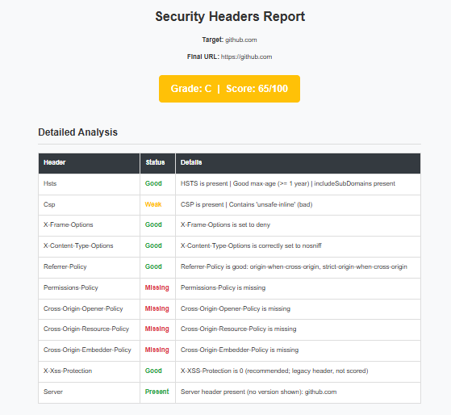

# SecureHeaderPro

A practical command-line tool that analyzes HTTP security headers of any website, scores them, and generates ready-to-use Nginx & Apache configuration fixes.

Built as a portfolio project to demonstrate practical application security knowledge, clean Python design, and secure coding practices.

---

## Why this project?

Many websites still ship with missing or weak security headers. SecureHeaderPro helps developers and security engineers quickly:

- See which important headers are missing or misconfigured
- Understand *why* a header is weak (not just “Present / Missing”)
- Get copy-paste Nginx and Apache configs to fix the issues
- Keep a clean HTML + text report of every scan

---

## Features

- Analyzes **11 security-relevant headers** with value-aware checks (not just presence)
- Gives a clear **score out of 100** and grade (A+ → F)
- Detects common weaknesses (low HSTS max-age, `unsafe-inline` / `unsafe-eval` in CSP, weak Referrer-Policy, version disclosure in Server header, etc.)
- Generates **Nginx and Apache** configuration snippets for missing *and* weak headers
- Saves timestamped **HTML + text reports** in a `reports/` folder
- Report generation **HTML-escapes** header values from the scanned site before writing them into the HTML report
- Non-zero exit code if the scan itself fails (for example, the site can't be reached). The exit code does not depend on the grade.
- Unit tests covering analysis, scoring, config generation, and report escaping

---

## Demo

Sample scan of `github.com`, taken on 18 Nov 2026. Results change as sites change their headers.



Full report: [docs/sample_report.html](docs/sample_report.html) (download it and open it in a browser; GitHub shows HTML files as source code).

---
## Installation

```bash
git clone https://github.com/yojeonggat-eun/secure-header-pro.git
cd secure-header-pro

python -m venv venv

# Windows
venv\Scripts\activate

# Linux / macOS
source venv/bin/activate

pip install -r requirements.txt
```

---

## Usage

```bash
# Run from the project's root folder
python src/secure_headers/cli.py example.com
python src/secure_headers/cli.py https://github.com
```

After each scan you will find:

- `reports/report_<site>_<timestamp>.html` — nice HTML report with analysis + fix configs
- `reports/scan_<site>_<timestamp>.txt` — plain text version

---

## How the score works

Each header has a fixed weight. The weights add up to exactly **100**.

| Header                        | Points | What earns the points |
|-------------------------------|--------|-----------------------|
| Content-Security-Policy       | 30     | Present (full points). Points deducted for `unsafe-inline` and `unsafe-eval` |
| Strict-Transport-Security     | 20     | Valid max-age (10) + max-age ≥ 1 year (+7) + `includeSubDomains` (+3) |
| X-Frame-Options               | 10     | `DENY` or `SAMEORIGIN` |
| X-Content-Type-Options        | 10     | Exactly `nosniff` |
| Referrer-Policy               | 10     | `no-referrer`, `same-origin`, `strict-origin`, or `strict-origin-when-cross-origin` |
| Permissions-Policy            | 8      | Present |
| Cross-Origin-Opener-Policy    | 4      | Present |
| Cross-Origin-Resource-Policy  | 3      | Present |
| Cross-Origin-Embedder-Policy  | 3      | Present |
| Server                        | 2      | Absent (2), name only (1), version exposed (0) |
| X-XSS-Protection              | 0      | Legacy header — reported only (`0` is the recommended value) |

**Grades**  
A+ ≥ 95 · A ≥ 85 · B ≥ 70 · C ≥ 55 · D ≥ 40 · F < 40

> **Note:** The weights and thresholds are my own heuristic, not an industry standard. Scores will differ from tools such as securityheaders.com or Mozilla Observatory, which use different checks and weights.
---

## Security notes

This tool was written with secure coding practices in mind:

- All untrusted data coming from the scanned website (header values, URLs) is **HTML-escaped** before being written into reports → prevents XSS in the generated HTML.
- CLI output escapes Rich markup in values taken from the scanned site.
- Generated configs are intentionally conservative. A strict CSP / COEP / CORP can break legitimate third-party resources — always test before deploying.

**Responsible use**  
Only scan websites you own or have explicit permission to test. The tool only performs a normal GET request and reads response headers.

---

## Limitations

- Only inspects the final response after redirects. Does not currently verify the HTTP → HTTPS redirect itself.
- CSP analysis is intentionally basic (flags `unsafe-inline` / `unsafe-eval`). It does not yet do full directive-level analysis or treat `frame-ancestors` as a full replacement for X-Frame-Options.
- Generated configuration is a **starting point**, not a production-ready hardened policy.
- The tool makes a single GET request, and headers can differ by page, cookies or User-Agent.
- The CSP check is a plain text match for `unsafe-inline` and `unsafe-eval`. It does not understand nonces or `strict-dynamic`, so it can report false positives.
- Permissions-Policy and the three Cross-Origin headers are scored on presence only, not on their values.
- The Server header check treats any digit in the value as a version number, so it can misjudge unusual values.

---

## Running the tests

```bash
pip install -r requirements-dev.txt
pytest
```

---

## Project structure

```text
secure-header-pro/
├── src/secure_headers/
│   ├── scanner.py      # Fetches headers (httpx)
│   ├── analyzer.py     # Value-aware analysis of each header
│   ├── scoring.py      # Weights, score calculation, grading
│   ├── generator.py    # Nginx & Apache config generation
│   ├── report.py       # HTML + text report generation (escapes header values)
│   └── cli.py          # Typer + Rich command-line interface
├── tests/              # Unit tests (pytest)
├── requirements.txt
├── requirements-dev.txt
└── README.md
```

---

## Future improvements

- Deeper CSP analysis (per-directive checks, wildcards, missing `object-src` / `base-uri` / `frame-ancestors`)
- Accept CSP `frame-ancestors` as a valid alternative to X-Frame-Options
- Cookie security flags (`Secure`, `HttpOnly`, `SameSite`) and `X-Powered-By` detection
- Verify HTTP → HTTPS redirect
- Multi-URL scanning + JSON output option
- Optional comparison against a previous scan

---

## Author

Built as a learning project.

Feedback and suggestions are welcome.
